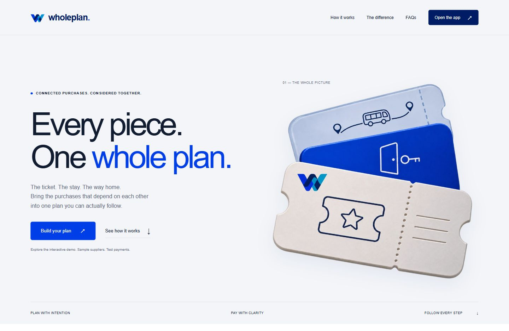

# WholePlan

WholePlan helps concert-trip buyers compare the cost and cancellation terms of a ticket, a room, and a return shuttle before paying. Gemini identifies the three purchases from the buyer’s request. WholePlan then compares complete bundles against the buyer’s budget and cancellation allowance.

The team tested Gemini intake and completed a three-seller checkout using PayPal Sandbox test funds. The shuttle-failure and refund walkthrough runs in WholePlan’s local simulator. Supplier inventory, prices, and booking confirmations are fictional in both modes.

- Compare the price and cancellation cost of eight complete bundles.
- Review separate seller approvals before capturing any payment.
- Track authorization holds, uncertain captures, refunds, and remaining charges.
- Download the activity and payment record for a plan in your browser session.



## Run locally

1. Install [Node.js 24 or newer](https://nodejs.org/en/download).
2. Clone this repository or choose **Code → Download ZIP** on GitHub and extract it.
3. Open a terminal in the folder containing `package.json`.
4. Run `npm start`. In Windows PowerShell, use `npm.cmd start`.
5. Leave the terminal open and visit [http://localhost:4317](http://localhost:4317) for the landing page or [http://localhost:4317/app](http://localhost:4317/app) for the workspace.

There are no npm dependencies to install. A fresh copy starts in **Simulation** mode and works without API keys.

The responsive workspace includes a quick-start guide, payment progress and an activity record. New saved-plan links use `/app?run=...`. Older `/#run=...` links redirect to the workspace. Browser sessions last 24 hours.

## Try the recovery demo

1. Keep the example concert-trip request. Set the budget to **$300** and the cancellation allowance to **$0**.
2. Under **Explore a scenario**, choose **Shuttle booking fails after the payments**.
3. Click **Compare my options**. The cheapest bundle costs **$220** and carries a **$35** cancellation penalty. The eligible **$245** bundle has **$0** in declared penalties.
4. Choose **Approve terms & prepare**, then **Complete this bundle**. The simulated payments complete, then the shuttle booking fails.
5. Click **Start recovery**. The payment summary shows **$245 charged** and **$245 refunded**, leaving a **$0 net charge** in this scenario.

The activity panel shows each payment and refund status. Use **Download record** to save a record of the run.

## Enable Gemini

1. Copy `.env.example` to `.env` in the project folder.
2. Create an API key in [Google AI Studio](https://aistudio.google.com/app/apikey) and enter it in `GEMINI_API_KEY`.
3. Set `GEMINI_MODEL=gemini-3.5-flash-lite`, the model used in our demo. Keep `PAYMENT_MODE=simulation` while testing Gemini on its own.
4. Restart WholePlan, uncheck **Use the sample itinerary**, and submit a request that includes a concert ticket, a room, and a return shuttle.

Gemini identifies the requested purchases and quotes supporting phrases from the buyer’s request. WholePlan’s application code applies the budget and cancellation limits and calculates the payment amounts.

## Enable PayPal Sandbox

1. In the [PayPal Developer Dashboard](https://developer.paypal.com/dashboard/), create or select three separate **Business Sandbox** accounts with a merchant app for each seller: ticket, hotel, and shuttle. Use a **Personal Sandbox** account as the buyer.
2. In your local `.env`, fill in the client ID and secret for each seller’s app using the matching `PAYPAL_TICKET_...`, `PAYPAL_HOTEL_...`, and `PAYPAL_SHUTTLE_...` fields. Use Sandbox credentials.
3. Set `PAYMENT_MODE=sandbox` and keep `PUBLIC_ORIGIN=http://localhost:4317`. Restart the app and open that exact address in the same browser throughout checkout.
4. Confirm the workspace badge says **PayPal Sandbox**. Compare and prepare a bundle, then approve each seller’s hold using the same Personal Sandbox buyer account. Return to WholePlan after each approval.
5. When all three holds are authorized, click **Complete this bundle**. For the $245 example, the expected total is **$245 held and $0 charged** before completion, followed by **$0 held and $245 charged** after all three captures complete.

Run `npm run paypal:smoke` to check the ticket app credentials and create and retrieve a $1.00 Sandbox test order. This is a separate check from the full checkout.

Keep `.env` and API credentials private. `.env.example` contains blank credential fields for anyone setting up their own copy.

## Configuration

| Setting | Default | Purpose |
| --- | --- | --- |
| `PORT` | `4317` | Local server port. |
| `PUBLIC_ORIGIN` | `http://localhost:<PORT>` | Browser origin, PayPal returns, and search metadata. |
| `PAYMENT_MODE` | `simulation` | Selects the simulator or `sandbox` for PayPal test funds. |
| `PAYPAL_{TICKET,HOTEL,SHUTTLE}_CLIENT_{ID,SECRET}` | Unset | Separate credentials for the three Sandbox sellers. |
| `GEMINI_API_KEY` | Unset | Enables model intake. Without it, the workspace offers the sample itinerary. |
| `GEMINI_MODEL` | `gemini-2.5-flash` | Runtime default when unset. The example file selects the recorded demo model. |
| `AI_REQUESTS_PER_HOUR` | `30` | Per-process Gemini call limit. Set to `0` to disable Gemini requests. |
| `WHOLEPLAN_DB` | `data/wholeplan.sqlite` | SQLite database path. |

## Development

The health endpoint reports the active payment mode. With the default configuration:

```sh
curl http://localhost:4317/health
# {"ok":true,"mode":"simulation"}
```

- `npm test` runs the automated suite.
- `npm run demo:evidence` writes local simulation results to `artifacts/scenarios.json`.

The HTTP server, payment engine, provider adapters, and store are in `src/`. The landing page and workspace are in `public/`, with source brand artwork in `design/brand/`. Tests are in `test/` and the command-line tools are in `scripts/`.

## Prototype scope

WholePlan supports the sample concert-trip bundle. Each seller’s Sandbox payment is authorized and captured separately. The simulator demonstrates supplier failures, refunds, and uncertain payment outcomes. The app uses fictional suppliers and Sandbox test funds.

## Security and search metadata

Find the demo notes, audit and contribution instructions in the [documentation index](docs/README.md). The [security review](docs/SECURITY-AUDIT.md) records the checks and deployment limits.

The public landing page has descriptive titles, canonical and social metadata, a 1200 × 630 preview image, a sitemap and crawler rules. Set `PUBLIC_ORIGIN` to the final HTTPS origin for deployment. Workspace and API routes carry noindex directives. Pages use local assets and system fonts.

## License

[MIT](LICENSE)
